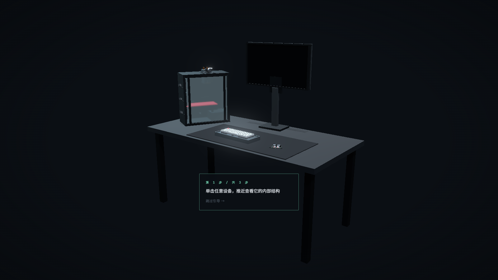
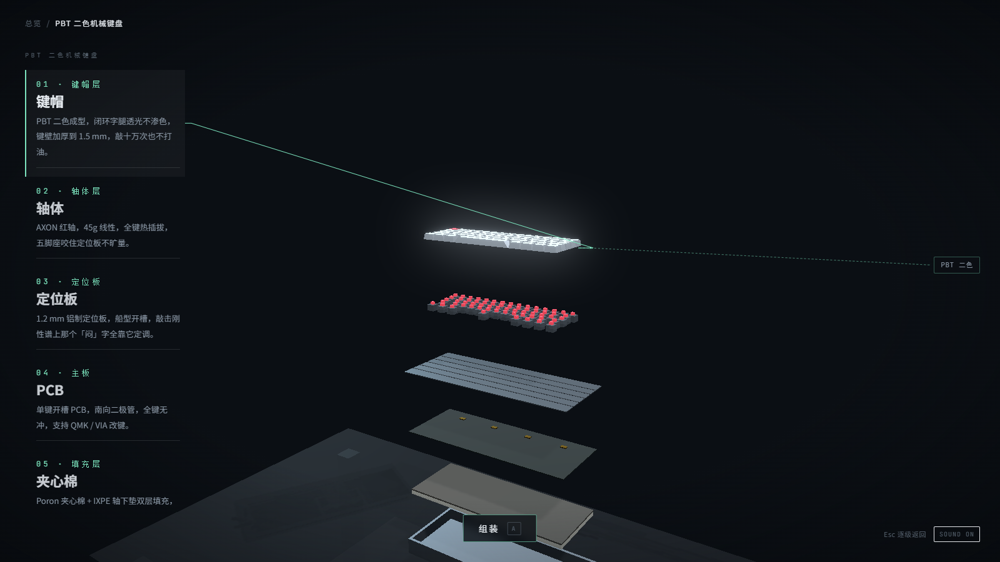
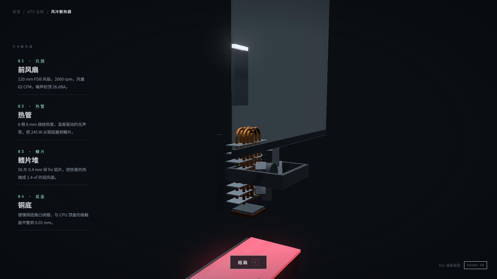
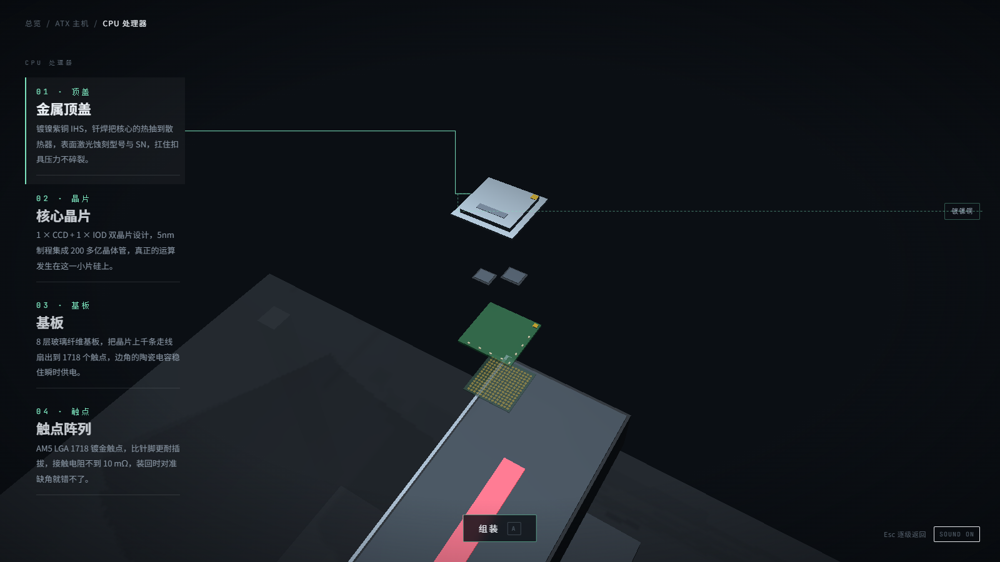

<div align="center">

# Virtual PC Builder

**计算机硬件拆解与组装交互实验室**
**An Interactive Lab to Disassemble, Explore & Reassemble a PC**

[中文](#中文) | [English](#english)


</div>

---

<a id="中文"></a>

## 中文

在一个黑暗质感、电影级打光的 3D 场景里，把摆放在桌上的一整套电脑（主机、显示器、键盘、鼠标）**逐层拆开、逐层读懂、再逐层装回去**。

所有模型由代码程序化构建，无需任何外部模型资产；层级行情文案（材料、工艺、量化参数）由 `src/data/devices.json` 数据驱动，改文案不需要动代码。

## 功能特性

- **总览场景**：桌面 + 四台设备，拖拽环绕、滚轮缩放，设备自带缓慢的呼吸式打光。
- **聚焦交互**：单击设备，相机沿阻尼曲线平滑推近，其余设备淡出，顶部出现面包屑（`总览 / 主机`）。
- **垂直爆炸拆解**：各层沿垂直方向按爆炸图展开，带 80ms stagger 节奏；支持 **二级拆解**（主机 → 风冷散热器 / CPU 处理器 / 显卡），面包屑逐级深入（`总览 / 主机 / CPU 处理器`）。
- **连线介绍**：单击任意一层，该层高亮、其余降暗，1px 直角导线连接 3D 层与左侧介绍栏，右侧同步显示短材料词卡。
- **组装动画**：按拆解逆序 stagger 归位，带"落座"回弹与 WebAudio 现场合成的咔哒音效（可静音）。
- **新手引导**：三步气泡引导，完成后写入 localStorage 不再出现，可随时跳过。
- **可访问性**：侧边栏条目支持 Tab + Enter 选中，Canvas 带模式描述 `aria-label`，所有动效尊重 `prefers-reduced-motion`。

## 截图预览

| 总览 | 键盘爆炸拆解 |
| --- | --- |
|  |  |
| **散热器二级拆解** | **CPU 二级拆解** |
|  |  |

## 技术栈

React 18 · TypeScript 5 · Vite 5 · three.js（@react-three/fiber + drei）· @react-three/postprocessing（Bloom）· Zustand · maath · TailwindCSS 3 · 原生 SVG 导线层

## 环境要求

- **Node.js ≥ 18**（Vite 5 的要求）与 npm
- 支持 WebGL2 的现代浏览器
- 可选联网：页面字体（Noto Sans SC / JetBrains Mono）从 Google Fonts 加载，离线时自动回落到系统字体栈

## 快速开始

```bash
# 安装依赖
npm install

# 启动开发服务器（http://127.0.0.1:5173）
npm run dev

# 类型检查 + 生产构建（输出到 dist/）
npm run build

# 本地预览生产构建
npm run preview
```

## 操作方式

| 输入 | 作用 |
| --- | --- |
| 拖拽 / 滚轮 | 环绕旋转 / 缩放 |
| 单击设备 | 相机聚焦该设备 |
| 双击设备 | 聚焦并直接拆解 |
| `E` / 拆解按钮 | 展开爆炸图 |
| `A` / 组装按钮 | 逆序组装归位 |
| 单击层 | 选中并显示连线介绍 |
| `Esc` / 面包屑 | 逐级返回 |
| Tab + Enter | 键盘遍历并选中侧边栏条目 |

## 项目结构

```
src/
├─ app/App.tsx            # 应用根：加载进度、全局快捷键（E / A / Esc）
├─ three/                 # R3F 组件（Canvas 内）
│  ├─ SceneRoot.tsx       # Canvas（dpr [1,2]、阴影、色调映射）
│  ├─ SceneManager.tsx    # 相机 rig / 灯光 rig / Bloom
│  ├─ DesktopScene.tsx    # 总览与聚焦/爆炸的每帧驱动
│  ├─ RaycastManager.tsx  # 拾取（点击 vs 拖拽判定、双击、hover）
│  ├─ pick-roots.ts       # 可拾取设备根注册表
│  ├─ three-bridge.ts     # 场景 → DOM 单向只读桥（连线投影用）
│  └─ models/             # 程序化模型工厂 + 层归组
├─ managers/              # 纯逻辑（无 JSX）
│  ├─ exploded.ts         # 爆炸偏移 / stagger 采样 / 层注册表
│  ├─ camera-tween.ts     # 相机阻尼补间
│  ├─ interaction.ts      # 输入语义化
│  └─ layer-driver.ts     # 每帧层驱动（位姿/高亮/降暗/呼吸/flash）
├─ ui/
│  ├─ panels/             # 左侧层级条目流 + 右侧材料词卡
│  ├─ connector/          # SVG 直角导线引擎（rAF 直写，不过 React）
│  └─ hud/                # 拆解/组装按钮、面包屑、Loading、引导、音效
├─ store/useAppStore.ts   # Zustand 唯一事实源（mode / devicePath / selectedLayerId …）
├─ data/devices.json      # 四台设备全量层级数据（文案数据驱动）
└─ styles/tokens.ts       # 设计 Token（颜色 / 动效 / 爆炸参数集中调参）
```

## 架构说明

**单向数据流**：输入 → store action → ① 3D 层在 `useFrame` 内读取 store 做阻尼插值（零 `setState`），② UI 层经 selector 订阅重渲。UI 与 3D 之间不持有引用，全部通过 store 解耦。

几处关键实现：

- **连线引擎**：选中层锚点每帧从世界坐标投影到屏幕坐标，直写 SVG `path.d`，绕过 React 状态，批量"先读后写"避免布局抖动。
- **实例化**：键帽、轴体、鳍片堆、扇叶等重复件使用 `InstancedMesh`，把上百个 draw call 收敛为个位数。
- **拾取优化**：只扫描"可见设备根注册表"，跳过桌面与已淡出的模型。
- **阴影按需重绘**：仅在过渡中或爆炸时钟在途时更新阴影贴图，静态帧跳过整个阴影 pass。
- **依赖分包**：three / react / 后处理各自独立 chunk，业务主包 gzip ≈ 27 KB。

更完整的设计与实现细节见 [docs/前端开发文档.md](docs/前端开发文档.md)。

## 关于模型资产

仓库不含 GLB 文件，`src/three/models/` 内置**程序化低模工厂**作为同构替代：mesh 命名遵循 `devices.json` 的 `nodeNames` 前缀约定，由通用 `groupLayers()` 按数据归组并注入 `userData`。未来若接入正式 GLB 资产，只需在 `models/registry.ts` 中替换加载方式，拾取 / 连线 / 高亮等业务代码零改动。

## 开发工具

```bash
# 重新生成 public/assets/icons/ 下的 30 个线性 SVG 图标
node scripts/gen-icons.mjs

# CDP 截图工具：启动 headless Chrome 对 dev server 截图并捕获 console
# 用法：node scripts/shot.mjs <名称> [等待毫秒] [页面JS]
# 可用环境变量 CHROME_PATH 指定 Chrome 路径（Windows）
node scripts/shot.mjs overview 6000
```

## License

本项目基于 [MIT License](LICENSE) 开源。

## Contributing

欢迎 Issue 与 PR：层级文案纠错、交互体验改进、文档完善都很欢迎；较大的改动请先开 Issue 讨论。

## Roadmap

- [ ] 接入正式 GLB 资产管线（Draco + KTX2 压缩），替换程序化模型
- [ ] LOD 双档（总览低模 / 聚焦高模）按相机距离自动切换
- [ ] 移动端触屏映射与低端机降级（关闭 Bloom、dpr 锁 1）
- [ ] 性能快照进 CI（draw call / 三角面预算）

---

<a id="english"></a>

## English

Disassemble a complete desktop setup (tower, monitor, keyboard, mouse) **layer by layer, understand every part, then put it all back together** — inside a dark, cinematically lit 3D scene.

Every model is built procedurally in code, with no external model assets. Layer descriptions (materials, processes, specs) are data-driven from `src/data/devices.json`, so copy changes never touch the code.

## Features

- **Overview scene**: a desk with four devices — orbit with drag, zoom with the wheel, and subtle breathing-light ambience.
- **Focus interaction**: click a device and the camera eases in along a damped path while the rest of the scene fades out; a breadcrumb appears (`Overview / Tower`).
- **Vertical exploded view**: layers separate vertically with an 80 ms stagger, plus **nested explosions** (Tower → CPU cooler / CPU / GPU) with multi-level breadcrumbs (`Overview / Tower / CPU`).
- **Callout lines**: click any layer to highlight it and dim the rest; a 1 px elbow connector ties the 3D layer to the sidebar description, with a short material chip on the right.
- **Assembly animation**: layers return in reverse order with a seat-in bounce and a WebAudio-synthesized click sound (mutable).
- **Onboarding**: a three-step bubble guide, remembered in localStorage, skippable at any time.
- **Accessibility**: sidebar entries support Tab + Enter, the canvas carries a mode-describing `aria-label`, and all motion respects `prefers-reduced-motion`.

## Screenshots

| Overview | Keyboard exploded view |
| --- | --- |
|  |  |
| **Cooler nested explosion** | **CPU nested explosion** |
|  |  |

## Tech Stack

React 18 · TypeScript 5 · Vite 5 · three.js (@react-three/fiber + drei) · @react-three/postprocessing (Bloom) · Zustand · maath · TailwindCSS 3 · native SVG connector layer

## Requirements

- **Node.js ≥ 18** (required by Vite 5) and npm
- A modern browser with WebGL2 support
- Optional network access: page fonts (Noto Sans SC / JetBrains Mono) load from Google Fonts and fall back to system fonts when offline

## Getting Started

```bash
# Install dependencies
npm install

# Start the dev server (http://127.0.0.1:5173)
npm run dev

# Type-check + production build (outputs to dist/)
npm run build

# Preview the production build locally
npm run preview
```

## Controls

| Input | Action |
| --- | --- |
| Drag / wheel | Orbit / zoom |
| Click device | Focus the camera on it |
| Double-click device | Focus and explode directly |
| `E` / Explode button | Explode into layers |
| `A` / Assemble button | Assemble in reverse order |
| Click a layer | Select it and show the callout |
| `Esc` / breadcrumb | Go back level by level |
| Tab + Enter | Traverse and select sidebar entries |

## Project Structure

```
src/
├─ app/App.tsx            # App root: loading progress, global shortcuts (E / A / Esc)
├─ three/                 # R3F components (inside the Canvas)
│  ├─ SceneRoot.tsx       # Canvas (dpr [1,2], shadows, tone mapping)
│  ├─ SceneManager.tsx    # Camera rig / lighting rig / Bloom
│  ├─ DesktopScene.tsx    # Per-frame driving for overview & focus/explode
│  ├─ RaycastManager.tsx  # Picking (click vs. drag, double click, hover)
│  ├─ pick-roots.ts       # Registry of pickable device roots
│  ├─ three-bridge.ts     # One-way read-only scene → DOM bridge (for connectors)
│  └─ models/             # Procedural model factories + layer grouping
├─ managers/              # Pure logic (no JSX)
│  ├─ exploded.ts         # Explode offsets / stagger sampling / layer registry
│  ├─ camera-tween.ts     # Damped camera tweening
│  ├─ interaction.ts      # Semantic input mapping
│  └─ layer-driver.ts     # Per-frame layer driving (pose/highlight/dim/breathe/flash)
├─ ui/
│  ├─ panels/             # Left layer entries + right material chips
│  ├─ connector/          # SVG elbow connector engine (rAF direct writes, no React)
│  └─ hud/                # Explode/assemble buttons, breadcrumb, loading, onboarding, sound
├─ store/useAppStore.ts   # Single Zustand source of truth (mode / devicePath / selectedLayerId …)
├─ data/devices.json      # Full layer data for all four devices (data-driven copy)
└─ styles/tokens.ts       # Design tokens (colors / motion / explode tuning in one place)
```

## Architecture Notes

**One-way data flow**: input → store action → ① the 3D layer reads the store inside `useFrame` and interpolates with damping (zero `setState`), ② UI components subscribe via selectors and re-render only on state changes. UI and 3D never hold references to each other; the store is the only bridge.

Implementation highlights:

- **Connector engine**: the selected layer's anchor is projected from world space to screen space every frame and written straight into the SVG `path.d`, bypassing React state; reads and writes are batched to avoid layout thrash.
- **Instancing**: repeated parts (keycaps, switches, fin stacks, fan blades) use `InstancedMesh`, collapsing hundreds of draw calls into single digits.
- **Picking**: raycasts only scan the "visible device root registry", skipping the desk and faded-out models.
- **On-demand shadows**: shadow maps update only during transitions or while the explosion clock is running; static frames skip the whole shadow pass.
- **Chunk splitting**: three / react / postprocessing ship as separate chunks; the app bundle is ≈ 27 KB gzipped.

See [docs/前端开发文档.md](docs/前端开发文档.md) (Chinese) for the full design document.

## About the Model Assets

The repo ships no GLB files; `src/three/models/` contains a **procedural low-poly factory** as a drop-in stand-in. Meshes follow the `nodeNames` prefix convention from `devices.json` and are grouped into layers by a shared `groupLayers()`. If real GLB assets arrive later, only the loader in `models/registry.ts` needs to change — picking, connectors and highlighting work unchanged.

## Developer Tools

```bash
# Regenerate the 30 linear SVG icons under public/assets/icons/
node scripts/gen-icons.mjs

# CDP screenshot tool: launches headless Chrome against the dev server,
# captures a PNG and the console output
# Usage: node scripts/shot.mjs <name> [waitMs] [pageJs]
# Set CHROME_PATH to override the Chrome executable (Windows)
node scripts/shot.mjs overview 6000
```

## License

Released under the [MIT License](LICENSE).

## Contributing

Issues and PRs are welcome — copy corrections, interaction improvements and docs are all good first contributions. Please open an issue first for larger changes.

## Roadmap

- [ ] GLB asset pipeline (Draco + KTX2) to replace the procedural models
- [ ] Dual LOD tiers (low-poly overview / high-poly focus) switched by camera distance
- [ ] Mobile touch mapping and low-end fallbacks (Bloom off, dpr locked to 1)
- [ ] Performance snapshots in CI (draw call / triangle budgets)
