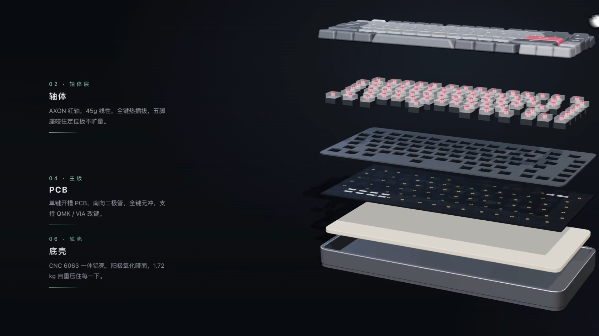

# Virtual PC Builder: An Interactive Exploration
## 计算机硬件拆解与组装交互网站 · 前端开发文档

| 项目 | 内容 |
| --- | --- |
| 文档版本 | v1.0 |
| 撰写日期 | 2026-08-30 |
| 撰写人 | 前端架构组 |
| 目标读者 | 计算机专业学生、前端开发工程师、3D 美术资产作者 |
| 视觉基准 | `docs/assets/reference-keyboard-exploded.png`（键盘爆炸图，下文简称 **image_0**） |
| 文档状态 | 评审稿（待资产团队确认 GLTF 命名约定后定稿） |

> **阅读须知**：本文档中所有涉及视觉规格的描述（颜色、排版、文案语气、连线形态）均以 image_0 为唯一权威基准。凡是本文档与 image_0 冲突之处，以 image_0 为准。

---

## 目录

- [0. 视觉基准解读：从 image_0 提炼的设计铁律](#0-视觉基准解读)
- [1. 项目规范](#1-项目规范-project-specification)
- [2. 技术栈架构](#2-技术栈架构-technology-stack)
- [3. 组件与模块架构](#3-组件与模块架构-component--module-architecture)
- [4. 交互逻辑与状态管理](#4-交互逻辑与状态管理-interaction-logic--state-management)
- [5. 数据结构设计](#5-数据结构设计-data-structure)
- [6. 性能与优化策略](#6-性能与优化策略-performance--optimization)
- [7. 开发路线图](#7-开发路线图-development-roadmap)
- [8. 附录](#8-附录)

---

<a id="0-视觉基准解读"></a>
## 0. 视觉基准解读：从 image_0 提炼的设计铁律

image_0 展示了一台机械键盘的垂直爆炸图，整站所有设备的拆解页必须复刻它的叙事结构。以下是从图中逐项取样得到的硬性规范：



### 0.1 布局分区

```
┌────────────────────────────────────────────────────────────────┐
│  [左侧栏 25%]          [中央 3D 画布 50%]        [右侧栏 25%]   │
│                                                                 │
│  02 · 轴体层                                    「Poron」       │
│  轴体                                           「PBT 二色」     │
│  AXON 红轴,45g 线性,                            「6063 铝」      │
│  全键热插拔,五脚                                                 │
│  座咬住定位板不旷量。                            (短词材料卡，    │
│  ─────────────                                   贴近对应层)     │
│  04 · 主板                                                      │
│  PCB                                                            │
│  单键开槽 PCB,南向二极管,                                        │
│  全键无冲,支持 QMK / VIA 改键。                                  │
│  ─────────────                                                  │
│  06 · 底壳                                                      │
│  底壳                                                           │
│  CNC 6063 一体铝壳,阳极氧化哑面,                                 │
│  1.72 kg 自重压住每一下。                                        │
│  ─────────────                                                  │
└────────────────────────────────────────────────────────────────┘
```

### 0.2 从图中取样的六条设计铁律

| # | 铁律 | 图中证据 |
| --- | --- | --- |
| L1 | **黑暗底、低饱和、单点霓虹**。背景是近乎纯黑的深蓝灰，唯一的强色是轴体的红；编号用低饱和薄荷青，其余文字全部为白/灰阶。 | 背景 ≈ `#0B0F14`；轴体红 ≈ `#FF4D5E`；编号青 ≈ `#7BE3BD` |
| L2 | **垂直爆炸，等距分层**。部件沿垂直方向（世界坐标 Y 轴）分离，间距均匀，从上到下为：键帽 → 轴体 → 定位板 → PCB → 夹心棉 → 底壳。 | 六层等间隔悬浮，带柔和投影 |
| L3 | **左侧栏 = 编号 + 层名 + 一句话人格化描述**。编号格式为 `0X · 层别词`（青色、宽字距、等宽数字），层名为白色粗体大字，描述为灰色、每条目下有一条细淡分隔线。 | `04 · 主板` / `PCB` / `单键开槽 PCB,南向二极管,全键无冲,支持 QMK / VIA 改键。` |
| L4 | **文案必须"精确到能触摸"**。所有描述都要带可验证的数字与工艺名词，并用一句有体感的短句收尾，禁止"高性能""优秀手感"这类空词。 | `CNC 6063 一体铝壳,阳极氧化哑面,1.72 kg 自重压住每一下`、`45g 线性`、`南向二极管` |
| L5 | **右侧栏 = 极短材料/规格词卡**。每个词卡仅一个短语（如 `Poron`），无编号、无描述，浮在对应层附近，由更细、更短的线牵引。 | 右侧 `Poron` 词卡 |
| L6 | **导线是配角**。线宽 ≈ 1px、低透明白/青色、直角折线（elbow），从层的侧缘水平引出，禁止贝塞尔曲线花活；线只在选中/悬停时提升亮度。 | 左侧文字与各层之间的细直线 |

### 0.3 设计 Token（初版，交由 `tokens.ts` 固化）

| Token | 值 | 用途 |
| --- | --- | --- |
| `--bg-base` | `#0B0F14` | 全局背景 / Canvas clearColor |
| `--bg-vignette` | `#05070A` | 页面四角暗角 |
| `--fg-primary` | `#E8EDF2` | 层名大字 |
| `--fg-secondary` | `#8A97A5` | 描述正文 |
| `--fg-tertiary` | `#55616D` | 分隔线、禁用态 |
| `--accent-red` | `#FF4D5E` | 轴体等 colorEmphasis 部件的发光/高亮 |
| `--accent-mint` | `#7BE3BD` | 编号 `0X ·` 前缀、导线选中态 |
| `--line-thin` | `rgba(232,237,242,0.18)` | 分隔线、默认导线 |
| `--font-num` | `"JetBrains Mono", ui-monospace` | 编号、规格数字 |
| `--font-cn` | `"Noto Sans SC", "HarmonyOS Sans SC", system-ui` | 中文正文与标题 |
| `--explode-gap` | `0.42 × 设备归一化高度` | 爆炸层间距（详见 4.3） |

排版细则：编号行 `letter-spacing: 0.35em`；层名 `font-weight: 700`，字号约为描述正文的 2 倍；描述行高 ≥ 1.8；每条目底部 1px 分隔线，宽度与文本列等宽，透明度 0.12。

---

<a id="1-项目规范-project-specification"></a>
## 1. 项目规范 (Project Specification)

### 1.1 项目标题

- **英文主标题**：`Virtual PC Builder: An Interactive Exploration`
- **中文副标题**：`计算机硬件拆解与组装交互实验室`
- **一句话定位**：在一个黑暗质感、电影级打光的 3D 场景里，把一台完整电脑（主机、显示器、键盘、鼠标）逐层拆开、逐层读懂、再逐层装回去。

### 1.2 核心功能描述

| 编号 | 功能 | 描述 | 对应章节 |
| --- | --- | --- | --- |
| F1 | **初始总览** (Overview) | 加载一台摆放在桌面上的完整电脑（主机、屏幕、键盘、鼠标、桌垫），支持拖拽环绕旋转、滚轮缩放。设备自带缓慢的呼吸式打光。 | 4.1 |
| F2 | **聚焦交互** (Zoom to Device) | 单击任一设备（如主机），相机沿贝塞尔路径平滑推近，其余设备淡出至远处虚化，被选设备占满画面中心。顶部出现面包屑 `总览 / 主机`。 | 4.2 |
| F3 | **拆解交互** (Explosion Mode) | 聚焦模式下点击「拆解」按钮或双击设备，内部各层沿垂直方向按爆炸图展开，动画带 stagger 节奏（自上而下依次弹开），完全对齐 image_0 的分层叙事。 | 4.3 |
| F4 | **连线介绍** (Highlight & Callout) | 单击爆炸图中任意一层（如 CPU、键盘 PCB），该层高亮 + 其余层降暗，一根 1px 直角导线从层侧缘连至侧边栏介绍框；左侧栏滚动定位到该层条目并展开详细规格，右侧栏同步显示短材料词卡。介绍内容严格遵循 image_0 文案风格（部件名、材料、工艺、精确数字如纳米制程/克重/频率）。 | 4.4 |
| F5 | **进一步拆解** (Nested Explosion) | 已爆炸的层中，可拆部件（如主机内的 CPU 风冷散热器、显卡）带发光角标提示；点击后相机二次推近，该层作为子设备再次爆炸，面包屑变为 `总览 / 主机 / 散热器`，支持逐级返回。 | 4.5 |
| F6 | **组装交互** (Assembly Mode) | 「组装」按钮触发反向动画：各层按拆解的逆序 stagger 归位，伴随进度百分比；归位瞬间有一次轻微"落座"回弹与音效。组装完成后可点击「返回总览」回到 F1。 | 4.6 |
| F7 | **新手引导** (Onboarding) | 首次进入显示三步引导（点击设备 → 拆解 → 点击层读介绍），可跳过；此后存入 localStorage 不再出现。 | 4.7 |

### 1.3 目标用户

| 用户群 | 典型场景 | 对产品的诉求 |
| --- | --- | --- |
| 硬件爱好者 | 选购前研究结构、云装机 | 规格精确、材质细节真实、能反复把玩 |
| 计算机专业学生 | 计算机组成原理课程的直观辅助 | 分层命名规范、附术语解释、有编号可检索 |
| 技术人员 / 装机从业者 | 向他人演示讲解、培训素材 | 动画流畅可投屏、操作路径短、面包屑清晰 |

**易用性约束**：全部核心流程可在「单击 + 两个按钮（拆解/组装）」内完成；所有层级跳转可由面包屑或 `Esc` 逐级返回；支持键盘 Tab 遍历侧边栏条目。

### 1.4 视觉与 UI 原则

1. **黑暗模式为唯一主题**。`#0B0F14` 为底，禁止纯白大面积出现；亮度靠部件本身的 PBR 反射与两三处霓虹强调（轴体红、编号青）撑起，形成 image_0 那种"深夜工作台"质感。
2. **层级感优先于信息量**。任何时刻画面上只有一个视觉主体：总览时是整套桌面；聚焦时是单设备；爆炸时是全部层；选中时是单层。其余信息一律降暗（透明度 ≤ 0.35）或虚化。
3. **侧边栏与连线严格复刻 image_0**：左侧栏承担"编号+层名+人格化描述"的纵向阅读流，右侧栏承担"一瞥即懂的短词卡"；导线永远是 1px 直角折线，不抢戏（铁律 L3/L5/L6）。
4. **文案的精确度就是产品的一部分**。所有部件描述必须包含：材料牌号（6063、Poron、FR4）、工艺（CNC、阳极氧化、二色成型）、量化参数（45g、1.72 kg、5nm、6000MT/s）三者中至少两项，并尽量以有体感的短句收尾。
5. **动效克制**：相机过渡 1.0–1.4s、层展开每层 0.5s + 80ms stagger、导线出现 200ms 淡入。全部使用帧率无关的阻尼插值，禁止生硬的线性动画。

---

<a id="2-技术栈架构-technology-stack"></a>
## 2. 技术栈架构 (Technology Stack)

### 2.1 选型总表

| 层 | 选型 | 版本基线 | 说明 |
| --- | --- | --- | --- |
| 框架 | **React 18 + TypeScript 5** | react@18.3 / ts@5.5 | 生态最全，R3F 绑定成熟 |
| 构建 | Vite 5 | vite@5.4 | 秒级 HMR；资产按 chunk 分包 |
| 3D 渲染核心 | **three.js** | >= 0.165 | WebGL2 渲染；自带 GLTFLoader/DRACOLoader/KTX2Loader |
| React 绑定 | **@react-three/fiber (R3F)** | ^8.17 | 声明式场景图，`useFrame` 承载每帧逻辑 |
| 3D 工具集 | @react-three/drei | ^9.114 | `Html`、`Detailed`(LOD)、`Instances`、`Environment`、`useGLTF` |
| 相机控制 | drei `CameraControls` + 自研 tween | — | 聚焦过渡用自研补间，交互旋转用 CameraControls |
| 状态管理 | **Zustand** | ^4.5 | 轻量、可在 React 外读取（R3F 的 `useFrame` 内不触发 React 重渲），详见 4.0 选型论证 |
| 动画 | maath（`easing.damp*`） | ^0.10 | 帧率无关阻尼插值，替代引入完整 GSAP；如后期需时间轴编排再补 GSAP |
| 后处理 | @react-three/postprocessing | ^2.16 | 仅 Bloom（霓虹红/青发光），半径小、半分辨率 |
| 物理（可选） | @react-three/rapier | ^1.4 | **Phase 5 评估项**：组装"落座"回弹若用纯弹簧不满意再引入；默认不启用以省体积 |
| UI 层 | DOM overlay + TailwindCSS 3 | — | 侧边栏、按钮、面包屑全部是 DOM，叠在 Canvas 之上 |
| 连线 | 原生 SVG 层 | — | 单独一层 `<svg>`，每帧直改 `path.d`，不过 React 状态 |
| 图标 | 自绘 SVG | — | 按数据结构 `icon` 字段下发，尺寸 20×20、线性 1.5px 描边 |
| 模型资产 | **GLTF/GLB**（Draco + KTX2） | — | Blender 建模 → gltf-transform 管线压缩 |

### 2.2 分层架构图

```
┌────────────────────────────────────────────────────────────┐
│  UI 层 (DOM, z-index 高于 Canvas)                            │
│  DescriptionPanelManager · ConnectorLineEngine(SVG)          │
│  HUD(拆解/组装按钮) · Breadcrumb · LoadingScreen              │
├────────────────────────────────────────────────────────────┤
│  状态层  Zustand store（唯一事实源）                          │
│  mode · activeDevicePath · selectedLayerId · progress …      │
├────────────────────────────────────────────────────────────┤
│  3D 层  R3F <Canvas>（与 UI 层唯一通道 = store）              │
│  SceneManager · ExplodedViewManager · InteractionManager     │
├────────────────────────────────────────────────────────────┤
│  资产层  AssetLoader                                         │
│  GLB(Draco+KTX2) · icons/*.svg · data/devices.json           │
└────────────────────────────────────────────────────────────┘
```

**单向数据流**：用户输入（InteractionManager / 按钮）→ dispatch store action → store 变化 → ① 3D 层在 `useFrame` 里读取 store 做阻尼插值（不重渲 React），② UI 层经 hook 订阅重渲。**UI 层与 3D 层之间禁止互相持有引用**，全靠 store 解耦。

### 2.3 两个关键选型的论证

- **为什么 Zustand 而不是 Redux/Pinia**：爆炸动画是"每帧读值、直接改对象属性"的高频路径，Redux 的 dispatch→reducer→订阅链在这条路径上是纯开销；Zustand 允许 `useStore.getState()` 在 `useFrame` 内零成本读取，且只有真正订阅了切片的 DOM 组件才重渲。项目状态量小（见 4.0），不需要 Redux 的中间件生态。若团队整体是 Vue 技术栈，等价映射为 **Vue 3 + Pinia + TresJS**，本文档第 3/4 章的模块边界不变。
- **为什么 GLB 而不是 FBX/OBJ**：GLB 单文件二进制、支持 Draco/Meshopt 几何压缩与 KTX2 纹理压缩、PBR 材质直接映射，且 Blender 导出零损耗——是 three 生态事实标准。

---

<a id="3-组件与模块架构-component--module-architecture"></a>
## 3. 组件与模块架构 (Component & Module Architecture)

### 3.1 组件树

```
<App>
 ├─ <StoreProvider>                        // Zustand（无需 Provider 亦可，此处为挂载初始化副作用）
 ├─ <Suspense fallback={<LoadingScreen/>}> // AssetLoader 预加载总览场景
 │   ├─ <Canvas dpr={[1,2]} shadows gl={{ antialias:true }}>
 │   │   ├─ <SceneManager>                 // 相机/灯光/环境/后处理/画布尺寸
 │   │   │   ├─ <CameraRig/>               // 相机补间 + CameraControls 挂载
 │   │   │   ├─ <LightingRig/>             // 主平行光 + 轮廓光 + Environment
 │   │   │   └─ <Effects/>                 // Bloom（半分辨率）
 │   │   ├─ <SceneContent>
 │   │   │   ├─ <DesktopScene/>            // F1 总览：四设备 + 桌面 + 桌垫
 │   │   │   ├─ <DeviceFocusRoot>          // F2~F6：当前聚焦设备容器
 │   │   │   │   └─ <ExplodedGroup device={d}>   // 爆炸容器
 │   │   │   │        ├─ <LayerNode layer={l}>   // 单层：原位/爆炸位插值、高亮
 │   │   │   │        │    └─ <NestedDevice/>    // F5 二级爆炸（递归）
 │   │   │   │        └─ ...
 │   │   │   └─ <ContactShadow/>           // 接触阴影（低成本）
 │   │   └─ <RaycastManager/>              // InteractionManager 的拾取实现
 │   └─ <UIOverlay>                        // DOM 层
 │       ├─ <DescriptionPanelManager/>     // 左右两侧边栏
 │       ├─ <ConnectorLayer/>              // SVG 导线层（同层还有右侧词卡锚点）
 │       ├─ <HUD>
 │       │   ├─ <ExplodeButton/>  <AssemblyButton/>
 │       │   └─ <Breadcrumb/>
 │       └─ <OnboardingOverlay/>
```

### 3.2 六大管理器职责与接口

每个管理器是一个**纯逻辑模块**（`src/managers/*.ts`）+ 一个薄 React 壳。职责边界如下：

| 模块 | 职责 | 关键接口（节选） |
| --- | --- | --- |
| **SceneManager** | 场景图生命周期：相机 rig、灯光 rig、后处理；管理 `overview / focus` 两种视角预设的补间；窗口 resize。 | `flyTo(pose: CameraPose, dur?: number): Promise<void>`<br>`restoreOverview(): Promise<void>` |
| **ExplodedViewManager** | 层级注册表：每台设备挂载时收集 `LayerNode` 引用；持有每层的 `assembledPos` 与 `explodeOffset`；驱动 `explosionProgress` 的阻尼插值与 stagger 调度；提供"当前选中层的锚点世界坐标"查询（供连线）。 | `registerLayer(node)` / `unregisterLayer(id)`<br>`setProgress(target: 0\|1)`<br>`getAnchorWorldPos(layerId): Vector3 \| null` |
| **InteractionManager** | 输入语义化：把 pointer 事件经 raycast 翻译成业务意图（hoverLayer / clickDevice / clickLayer / dblclick），并做点击 vs 拖拽判定（位移阈值 6px）；管理 hover 光标与轮廓高亮。 | `bind(canvas)` / `dispose()`<br>输出：`store.actions.*` |
| **DescriptionPanelManager** | 侧边栏渲染：从 store 读 `selectedLayerId` 与当前设备数据，渲染左侧条目流（编号/层名/描述/分隔线）与右侧短词卡；选中变化时滚动定位 + 内容淡入。 | 纯展示组件，无对外接口 |
| **ConnectorLineEngine** | 动态连线：每帧把选中层的锚点从世界坐标投影到屏幕坐标，生成直角折线 `path`，直写 SVG DOM（绕过 React）；处理层在相机背后、面板换行、词卡多锚点三种情形。 | `attach(svgEl, panelEl)`<br>内部 rAF 循环 |
| **AssetLoader** | GLTF 与数据资产：`useGLTF` 按设备懒加载 + `preload` 总览包；注册 DRACO/KTX2 解码器；校验 GLB 内 mesh 命名与 `layer.nodeNames` 一致（dev 模式警告）；暴露加载进度给 LoadingScreen。 | `useDeviceModel(url)`<br>`preloadOverview()` |

### 3.3 数据流时序（以「点击键盘 PCB 层」为例）

```
用户单击 PCB 层
 → RaycastManager 命中 mesh → InteractionManager 查 mesh.userData.layerId
 → store.selectLayer('kbd','pcb')
    ├→ ExplodedViewManager（useFrame 内）：PCB 层 emissive 提亮，其余层透明度降为 0.35
    ├→ DescriptionPanelManager（React 订阅）：左侧栏滚动至 04 条目并高亮，右侧挂载「QMK / VIA」词卡
    └→ ConnectorLineEngine（rAF）：每帧 getAnchorWorldPos('pcb') → 投影 → 直写 <path d>
```

### 3.4 源码目录结构

```
src/
├─ app/                  # App.tsx、路由（单页，仅锚点）、全局 Provider
├─ three/                # R3F 组件（Canvas 内）
│  ├─ SceneManager.tsx
│  ├─ ExplodedGroup.tsx  # LayerNode、NestedDevice 同文件
│  ├─ DesktopScene.tsx
│  └─ RaycastManager.tsx
├─ managers/             # 纯逻辑（无 JSX）
│  ├─ exploded.ts  interaction.ts  camera-tween.ts
├─ ui/                   # DOM 层
│  ├─ panels/   # DescriptionPanelManager、LayerEntry、MaterialChip
│  ├─ connector/# ConnectorLineEngine、ConnectorLayer
│  ├─ hud/      # 按钮、面包屑、LoadingScreen、Onboarding
├─ store/                # useAppStore.ts（切片合并）
├─ data/                 # devices.json（第 5 章）、types.ts
├─ assets/
│  ├─ models/   # keyboard.glb / pc-tower.glb / monitor.glb / mouse.glb
│  └─ icons/    # *.svg
└─ styles/tokens.ts      # 0.3 节设计 Token 的 TS 常量（供 3D 与 UI 共用）
```

---

<a id="4-交互逻辑与状态管理-interaction-logic--state-management"></a>
## 4. 交互逻辑与状态管理 (Interaction Logic & State Management)

<a id="4-0-全局状态机"></a>
### 4.0 全局状态机

```
                 clickDevice            explode              clickLayer
 ┌──────────┐ ─────────────► ┌─────────┐ ─────────► ┌──────────┐ ─────────► ┌────────────┐
 │ OVERVIEW │                │  FOCUS  │            │ EXPLODED │            │ INSPECTING │
 └──────────┘ ◄───────────── └─────────┘ ◄───────── └──────────┘ ◄───────── └────────────┘
       ▲        back (Esc)       ▲   assemble(组装)     │                deselect(再点空白)
       │                         │                      │ clickNested
       │      assemble+back      │                      ▼
       └─────────────────────────┴────────────── NESTED_EXPLODED ──(Esc 逐级返回)──┘
```

- 每个模式都由 **`mode` + `activeDevicePath: string[]` + `selectedLayerId`** 三元组唯一确定，切换即"补间过去"，没有割裂的跳页。
- `Esc` / 面包屑：`NESTED_EXPLODED → EXPLODED → FOCUS → OVERVIEW` 逐级回退。
- **任何模式切换期间输入被锁**（`transitioning: true`），防止动画中途连点导致的相机漂移。

**选型论证（为什么是 Zustand）**：3D 侧每帧需要读取 `explosionProgress`、选中态等做插值——Zustand 允许在 `useFrame` 里 `useAppStore.getState()` 直接读，不经过 React 渲染；只有 UI 面板用 selector 订阅各自切片。Redux 的样板代码与本项目的状态规模不匹配；Pinia 仅在 Vue 方案下作为等价替代。

Store 完整定义：

```ts
// src/store/useAppStore.ts
import { create } from 'zustand'

type Mode = 'overview' | 'focus' | 'exploded' | 'nested' | 'inspecting'

interface AppState {
  mode: Mode
  transitioning: boolean          // 相机/爆炸动画播放期间锁输入
  devicePath: string[]            // 如 ['main-pc-01','cpu-cooler']，长度=层级深度
  selectedLayerId: string | null  // 当前选中层（连线+高亮）
  hoverLayerId: string | null
  explosionProgress: Record<string, number> // deviceId -> 0(组装)~1(拆解)，供 useFrame 读取
  onboardingSeen: boolean

  // —— actions ——
  enterDevice: (deviceId: string) => Promise<void>   // OVERVIEW → FOCUS
  explode: () => Promise<void>                       // FOCUS → EXPLODED
  assemble: () => Promise<void>                      // EXPLODED → FOCUS
  selectLayer: (layerId: string | null) => void
  enterNested: (layerId: string) => Promise<void>    // EXPLODED → NESTED
  back: () => Promise<void>                          // Esc / 面包屑逐级返回
}
```

**输入映射表**：

| 输入 | OVERVIEW | FOCUS | EXPLODED / INSPECTING |
| --- | --- | --- | --- |
| 左键单击设备 | 聚焦该设备 | — | — |
| 左键单击层 | — | — | 选中层 → 连线介绍（再点空白取消） |
| 左键单击可拆层（带角标） | — | — | 进入二级拆解 |
| 双击设备 | 聚焦并直接拆解 | 触发拆解 | — |
| 拖拽 | 环绕旋转 | 环绕（限制极角） | 环绕（限制极角更窄） |
| 滚轮 | 缩放（限距） | 缩放 | 缩放 |
| `E` / 拆解按钮 | — | 拆解 | — |
| `A` / 组装按钮 | — | — | 组装 |
| `Esc` / 面包屑 | — | 返回总览 | 逐级返回 |
| Tab（侧边栏聚焦） | — | — | 选中对应层（无障碍路径） |

### 4.1 初始视图 (Overview)

- 场景内容：桌面 + 桌垫 + 主机 + 显示器 + 键盘 + 鼠标，全部为**低模 LOD0 资产**（见 6.2），相机默认 3/4 俯视位。
- 交互：OrbitControls（drei `CameraControls`），`minDistance/maxDistance` 限制在桌面尺度；自动极角钳制防止钻到桌下。
- 氛围：主平行光 + 环境贴图（`RoomEnvironment`，无需外部 HDRI 文件）+ 接触阴影；设备 LED（主机灯条、轴体红）以微弱 emissive 呼吸（sin 驱动，周期 4s，幅度 5%）。
- 加载策略：总览包（四设备 LOD0 + 桌面）合计目标 ≤ 8MB，`Suspense` 兜底 + LoadingScreen 显示 AssetLoader 进度。

### 4.2 聚焦交互 (Zoom to Device)

点击设备后：

1. `InteractionManager` 命中设备根 Group（`userData.deviceId`）→ `store.enterDevice(id)`。
2. `SceneManager.flyTo(device.focusCamera)`：相机 position 与 OrbitControls target **同时**沿 `easeInOutCubic` 补间 1.2s；期间 `transitioning=true` 锁输入，其余设备透明度 damp 至 0（并 `visible=false` 收尾）。
3. 相机就位后解锁输入，HUD 出现「拆解」按钮与面包屑 `总览 / 主机`。

```ts
// managers/camera-tween.ts（核心节选）
import { damp3 } from 'maath/easing'

// 每帧调用；target 由 store.mode/devicePath 推导出的目标位姿
export function updateCameraRig(camera, controls, targetPose, delta, onArrive) {
  damp3(camera.position, targetPose.position, 0.35, delta)   // 帧率无关阻尼
  damp3(controls.target, targetPose.target, 0.35, delta)
  controls.update()
  if (camera.position.distanceTo(targetPose.position) < 0.01) onArrive?.()
}
```

每台设备的 `focusCamera` 位姿在 `devices.json` 中由美术摆好后录出（见第 5 章），**不写死在代码里**。

### 4.3 拆解交互 (Explosion Mode)

- **触发**：聚焦模式下点击 HUD「拆解」按钮、按 `E`、或双击设备。
- **偏移计算**：层沿世界 Y 轴垂直分离（铁律 L2）。归一化后每层爆炸位：

```ts
// managers/exploded.ts（核心节选）
// layers 已按拆解顺序（自上而下）排序；gap 由设备数据里的 explodeGap 提供
export function computeExplodeOffsets(layers: LayerDef[], gap: number) {
  const n = layers.length
  const mid = (n - 1) / 2
  return layers.map((_, i) => ({ x: 0, y: (i - mid) * gap, z: 0 }))
  // 中间层不动，上下各层对称展开——复刻 image_0 的等距悬浮构图
}
```

- **动画编排**：全局 `explosionProgress[deviceId]` 0→1 阻尼推进；每层额外带 stagger——`layerDelay = index * 0.08s`，即进度对每层做时间平移采样，形成自上而下依次弹开的节奏：

```ts
// three/ExplodedGroup.tsx（useFrame 内节选）
useFrame((_, delta) => {
  const t = useAppStore.getState().explosionProgress[deviceId] // 0~1
  layers.forEach((layer, i) => {
    const local = clamp01((t * (1 + maxStagger) - i * staggerStep)) // stagger 平移采样
    const e = easeOutCubic(local)
    damp3(node.position, [base.x, base.y + offsets[i].y * e, base.z], 0.22, delta)
  })
})
```

- **配合演出**：爆炸瞬间主光亮度 damp 至 1.2 倍并轻微上移，接触阴影随层间距淡出；轴体层等 `colorEmphasis` 部件 emissive 增强（配 Bloom 微光，即 image_0 的红色霓虹观感）。
- **完成态**：全部层到位后 `mode='exploded'`，侧边栏条目流淡入，默认预选 `layers[0]`（键帽层）以立即呈现图文结构。

### 4.4 连线介绍 (Highlight & Callout)

选中层后的完整链路（对应铁律 L3/L5/L6）：

1. **高亮**：选中层材质 emissive 提亮 + 外描边（`EffectComposer` 外的 SelectiveBloom 或轻量 outline pass 二选一，Phase 4 定）；其余层整体透明度 damp 至 0.35。
2. **锚点**：取该层包围盒朝向侧边栏一侧的边中点为世界坐标锚点（`ExplodedViewManager.getAnchorWorldPos`）。
3. **投影**：每帧把锚点 `vector.project(camera)` 转屏幕像素：

```ts
// ui/connector/ConnectorLineEngine.ts（核心节选）
function worldToScreen(v: THREE.Vector3, camera, w: number, h: number) {
  const p = v.clone().project(camera)
  return { x: (p.x * 0.5 + 0.5) * w, y: (-p.y * 0.5 + 0.5) * h, behind: p.z > 1 }
}
// 直角折线：锚点 → 水平引出 24px → 竖直对齐面板条目中线 → 水平进面板
path.setAttribute('d', `M${a.x},${a.y} L${a.x + 24},${a.y} L${panelX - 12},${entryY} L${panelX},${entryY}`)
```

4. **遮挡与失效**：`behind=true`（层在相机背面）或层透明度 < 0.3 时整根线 `opacity=0`，200ms 淡出。
5. **左侧栏内容**（严格 image_0 结构）：`0X · 层别词`（青色编号 + 全角间隔点）→ 层名（白粗体）→ 描述（灰，含精确规格）→ 1px 分隔线。选中条目自动 `scrollIntoView({ block:'center' })`。
6. **右侧栏词卡**：一个短语（材料/关键规格，如 `Poron`、`5nm`、`850W`），青色细边框、透明底，锚定在对应层右侧；同样由 ConnectorLineEngine 用更短、更细的引线牵引。
7. **性能红线**：投影与 `path` 直写全部在 rAF 内完成，**不经过 React 状态**；每帧成本预算 ≤ 0.3ms（见 6.5）。

### 4.5 进一步拆解 (Nested Explosion)

- 可再拆层在数据中声明 `nested: DeviceDef`（如 主机 → 散热器 → 风扇/热管/鳍片/铜底）。该层右上角有青色角标 + hover 提示「可进一步拆解」。
- 点击后：`store.enterNested(layerId)` → 相机二次推近该层 → 该层从父爆炸组中"提升"为子 ExplodedGroup，父层其余部分降暗至 0.2 → 子层按 4.3 同一套逻辑爆炸。面包屑 `总览 / 主机 / 散热器`。
- **实现要点**：`ExplodedGroup` 是递归组件，`devicePath` 长度即递归深度；连线、侧边栏逻辑完全复用，仅数据上下文切换为子设备。**深度上限 2 级**（v1 范围），更深在数据模型上允许、UI 上暂不开放。

### 4.6 组装交互 (Assembly Mode)

- **触发**：爆炸态点击「组装」按钮或按 `A`。
- **反向编排**：`explosionProgress` 1→0，stagger 顺序取拆解的**逆序**（底壳先落座、键帽最后盖上），层到位时做一次 4% 的 Y 轴过冲回弹（阻尼系数调小一档即自然出现）。
- **进度反馈**：HUD 按钮文案变为 `组装中 63%`；完成时触发一次 80ms 的整灯 flash（emissive 脉冲）+ 可选落座音效（资源就位后启用，Mute 开关常驻 HUD）。
- **完成**：`mode='focus'`，提示「返回总览」；若用户直接点其他设备，自动先静默完成组装再切换。
- **物理说明**：v1 的"落座回弹"用阻尼过冲实现；若 Phase 5 评审认为需要真实碰撞（零件相互挤入检测），再引入 Rapier，仅对组装最后 10% 进度启用——默认不引入，避免 3MB+ WASM 体积。

### 4.7 引导与可访问性

- 首次进入的三步气泡引导（F7）用 DOM 实现，指向真实 DOM/Canvas 命中区域；`localStorage['vpc.onboarding']='done'`。
- 侧边栏条目可 Tab 聚焦，`Enter` 等价点击选中（触发同一 action）；Canvas 区域 `aria-label` 描述当前模式；所有动效尊重 `prefers-reduced-motion`（命中时相机过渡与爆炸改为 200ms 直切）。

---

<a id="5-数据结构设计-data-structure"></a>
## 5. 数据结构设计 (Data Structure)

### 5.1 TypeScript 接口（权威定义，`src/data/types.ts`）

```ts
/** 单个可拆解设备的完整定义 */
export interface DeviceDef {
  id: string
  name: string                     // 展示名，如「PBT 二色机械键盘」
  modelUrl: string                 // GLB 路径（Draco+KTX2 已压缩）
  explodeGap: number               // 爆炸层间距（该设备归一化单位）
  focusCamera: CameraPose          // 聚焦位姿（美术在场景内摆好后导出）
  layers: LayerDef[]               // 拆解顺序 = 数组顺序（自上而下）
}

export interface CameraPose {
  position: [number, number, number]
  target: [number, number, number]
  fov?: number
}

/** 爆炸图中的一个层 */
export interface LayerDef {
  id: string                       // 'switches'
  index: number                    // 展示编号 1-based → 渲染为 02 样式
  name: string                     // 层名「轴体」
  category: string                 // 编号后的层别词「轴体层」「主板」「底壳」
  description: string              // 左侧栏人格化长描述（铁律 L4 的精确文案）
  materialChip: string             // 右侧栏短词卡「Poron」「6063 铝」
  icon: string                     // 图标路径
  colorEmphasis?: 'red' | 'mint'   // 霓虹强调色（轴体=red，对应 image_0）
  nodeNames: string[]              // GLB 内归属该层的 mesh 名前缀（拾取与归组依据）
  anchor: 'left' | 'right'         // 连线引出方向
  nested?: DeviceDef               // 可进一步拆解的子设备（4.5）
}
```

### 5.2 顶层清单（`src/data/devices.json`，节选自完整文件）

```json
{
  "computerId": "main-pc-01",
  "scene": { "desktopModel": "/assets/models/desk.glb" },
  "devices": {
    "keyboard": {
      "id": "kbd-01",
      "name": "PBT 二色机械键盘",
      "modelUrl": "/assets/models/keyboard.glb",
      "explodeGap": 0.42,
      "focusCamera": { "position": [0.9, 1.35, 1.6], "target": [0, 0.1, 0] },
      "layers": [
        {
          "id": "keycaps",  "index": 1, "name": "键帽", "category": "键帽层",
          "description": "PBT 二色成型，闭环字腿透光不渗色，键壁加厚到 1.5 mm，敲十万次也不打油。",
          "materialChip": "PBT 二色", "icon": "/assets/icons/keycap.svg",
          "nodeNames": ["keycap"], "anchor": "right"
        },
        {
          "id": "switches", "index": 2, "name": "轴体", "category": "轴体层",
          "description": "AXON 红轴，45g 线性，全键热插拔，五脚座咬住定位板不旷量。",
          "materialChip": "AXON 红轴", "icon": "/assets/icons/switch.svg",
          "colorEmphasis": "red", "nodeNames": ["switch"], "anchor": "left"
        },
        {
          "id": "plate",    "index": 3, "name": "定位板", "category": "定位板",
          "description": "1.2 mm 铝制定位板，船型开槽，敲击刚性谱上那个\"闷\"字全靠它定调。",
          "materialChip": "6061 铝", "icon": "/assets/icons/plate.svg",
          "nodeNames": ["plate"], "anchor": "right"
        },
        {
          "id": "pcb",      "index": 4, "name": "PCB", "category": "主板",
          "description": "单键开槽 PCB，南向二极管，全键无冲，支持 QMK / VIA 改键。",
          "materialChip": "QMK / VIA", "icon": "/assets/icons/pcb.svg",
          "nodeNames": ["pcb"], "anchor": "left"
        },
        {
          "id": "foam",     "index": 5, "name": "夹心棉", "category": "填充层",
          "description": "Poron 夹心棉 + IXPE 轴下垫双层填充，把空腔音压成一段干净的底鼓。",
          "materialChip": "Poron", "icon": "/assets/icons/foam.svg",
          "nodeNames": ["foam", "ixpe"], "anchor": "right"
        },
        {
          "id": "bottom",   "index": 6, "name": "底壳", "category": "底壳",
          "description": "CNC 6063 一体铝壳，阳极氧化哑面，1.72 kg 自重压住每一下。",
          "materialChip": "6063 铝", "icon": "/assets/icons/case.svg",
          "nodeNames": ["bottom_case", "feet"], "anchor": "left"
        }
      ]
    },

    "pc-tower": {
      "id": "tower-01",
      "name": "ATX 主机",
      "modelUrl": "/assets/models/pc-tower.glb",
      "explodeGap": 0.38,
      "focusCamera": { "position": [1.4, 1.1, 2.2], "target": [0, 0.35, 0] },
      "layers": [
        { "id": "glass",  "index": 1, "name": "侧透面板", "category": "面板",
          "description": "4 mm 钢化玻璃，铰链快拆，里头每根灯条的位置都是留给它的舞台。",
          "materialChip": "钢化玻璃", "icon": "/assets/icons/glass.svg",
          "nodeNames": ["side_glass"], "anchor": "left" },
        { "id": "cooler", "index": 2, "name": "风冷散热器", "category": "散热",
          "description": "双塔六热管风冷，解热 245 W，压 5nm 的旗舰 CPU 烤机不过 72 ℃。",
          "materialChip": "6 热管", "icon": "/assets/icons/cooler.svg",
          "nodeNames": ["cooler"], "anchor": "right",
          "nested": {
            "id": "cooler-nested", "name": "风冷散热器", "modelUrl": "/assets/models/cooler.glb",
            "explodeGap": 0.5,
            "focusCamera": { "position": [0.6, 0.5, 1.0], "target": [0, 0, 0] },
            "layers": [
              { "id": "fan-front", "index": 1, "name": "前风扇", "category": "风扇",
                "description": "120 mm FDB 风扇，2000 rpm，风量 62 CFM，噪声封顶 26 dBA。",
                "materialChip": "FDB 轴承", "icon": "/assets/icons/fan.svg",
                "nodeNames": ["fan_front"], "anchor": "left" },
              { "id": "heatpipes", "index": 2, "name": "热管", "category": "热管",
                "description": "6 根 6 mm 烧结热管，温差驱动的无声泵，把 245 W 从铜底搬到鳍片。",
                "materialChip": "烧结铜", "icon": "/assets/icons/pipe.svg",
                "nodeNames": ["heatpipe"], "anchor": "right" },
              { "id": "fins", "index": 3, "name": "鳍片堆", "category": "鳍片",
                "description": "56 片 0.4 mm 穿 fin 铝片，把热管的热摊成 1.4 ㎡ 的迎风面。",
                "materialChip": "穿 FIN 铝", "icon": "/assets/icons/fins.svg",
                "nodeNames": ["fin_stack"], "anchor": "left" },
              { "id": "coldplate", "index": 4, "name": "铜底", "category": "底座",
                "description": "镀镍铜底微凸研磨，与 CPU 顶盖的接触面平整到 0.01 mm。",
                "materialChip": "镀镍铜", "icon": "/assets/icons/coldplate.svg",
                "nodeNames": ["cold_plate"], "anchor": "right" }
            ]
          } },
        { "id": "ram",    "index": 3, "name": "内存", "category": "内存",
          "description": "DDR5 6000 MT/s CL30 16G×2，海力士 A-die，EXPO 一键超频。",
          "materialChip": "DDR5 6000", "icon": "/assets/icons/ram.svg",
          "nodeNames": ["dimm"], "anchor": "left" },
        { "id": "gpu",    "index": 4, "name": "显卡", "category": "显卡",
          "description": "三风扇 3.5 槽旗舰，5nm 核心含 16384 CUDA 核心，功耗墙 450 W。",
          "materialChip": "5nm", "icon": "/assets/icons/gpu.svg",
          "colorEmphasis": "red", "nodeNames": ["gpu"], "anchor": "right" },
        { "id": "ssd",    "index": 5, "name": "固态硬盘", "category": "存储",
          "description": "M.2 2280 PCIe 4.0，独立缓存 2 GB，顺序读 7400 MB/s。",
          "materialChip": "PCIe 4.0", "icon": "/assets/icons/ssd.svg",
          "nodeNames": ["m2_ssd"], "anchor": "left" },
        { "id": "mobo",   "index": 6, "name": "主板", "category": "主板",
          "description": "ATX B650，16+2+1 相供电，2.5G 网卡与 Wi-Fi 6E 一体。",
          "materialChip": "B650", "icon": "/assets/icons/mobo.svg",
          "nodeNames": ["motherboard"], "anchor": "right" },
        { "id": "psu",    "index": 7, "name": "电源", "category": "电源",
          "description": "ATX 3.0 850W 金牌全模组，原生 12VHPWR，平均无故障 10 万小时。",
          "materialChip": "850W 金牌", "icon": "/assets/icons/psu.svg",
          "nodeNames": ["psu"], "anchor": "left" },
        { "id": "chassis","index": 8, "name": "机箱骨架", "category": "机箱",
          "description": "0.8 mm SPCC 钢板骨架，四面快拆，1.2 mm 立柱扛住全部重量。",
          "materialChip": "SPCC 钢", "icon": "/assets/icons/chassis.svg",
          "nodeNames": ["chassis"], "anchor": "right" }
      ]
    },

    "monitor": { "id": "mon-01", "name": "27″ 4K 显示器", "modelUrl": "/assets/models/monitor.glb",
      "explodeGap": 0.45, "focusCamera": { "position": [0, 1.2, 1.8], "target": [0, 0.5, 0] },
      "layers": [ /* 面板模组 / 背光板 / 驱动板 / 电源板 / 外壳 / 支架，结构同上，略 */ ] },

    "mouse": { "id": "mouse-01", "name": "轻量化无线鼠标", "modelUrl": "/assets/models/mouse.glb",
      "explodeGap": 0.5, "focusCamera": { "position": [0.3, 0.9, 0.9], "target": [0, 0.1, 0] },
      "layers": [ /* 上盖 / 微动 / 滚轮编码器 / PCB / 电池 / 底盖脚贴，结构同上，略 */ ] }
  }
}
```

### 5.3 GLTF 命名约定（AssetLoader 校验依据）

- 每个层的 mesh 命名必须以 `nodeNames` 中的前缀开头，如 `switch_00`…`switch_103`（87 键轴体全部实例化，见 6.4）。
- 单层多 mesh 时归组到 `THREE.Group`，Group 名 = `layer.id`；拾取时只 raycast 到 Group 层级，`userData.layerId` 由 AssetLoader 统一注入。
- **交付验收脚本**：`npm run validate-models` 逐 GLB 比对 `devices.json`，缺失/多余 mesh 在 CI 直接报错。

---

<a id="6-性能与优化策略-performance--optimization"></a>
## 6. 性能与优化策略 (Performance & Optimization)

### 6.1 资产优化

| 手段 | 工具 | 目标 |
| --- | --- | --- |
| 几何压缩 | `gltf-transform optimize --draco`（键帽等规则件用 meshopt 更快解压） | GLB 体积降 60–80% |
| 纹理压缩 | `gltf-transform etc1s/uastc` → **KTX2** | 显存占用降 60%+，免 CPU 解码 PNG |
| 按需加载 | 设备级代码分割：聚焦某设备时才 `useGLTF(设备包)`；总览只拉 LOD0 包 | 首屏网络 ≤ 8MB |
| 预热 | 总览页空闲时 `useGLTF.preload` 其余设备的 LOD0 | 聚焦切换零白屏 |
| 解码器 | DRACOLoader/KTX2Loader 的 decoder 走 CDN 本地副本 + `Cache` | 避免重复下载 |

### 6.2 模型 LOD

- 每设备交付 **两档**：`*.lod0.glb`（总览远景，≈3 万三角面/台）、`*.hi.glb`（聚焦+爆炸，≈12 万面/台）。用 drei `<Detailed distances={[0, 2.5, Infinity]}>` 按**与相机距离**自动切换。
- 切换时机与拆解联动：进入聚焦态强制锁 hi 档并 `preload`，避免爆炸动画中途换模闪烁。
- 爆炸层内的小件（螺丝、脚贴）只在 hi 档存在，LOD0 中合并进父壳。

### 6.3 纹理与材质

- 全量 **PBR**（metalness/roughness 工作流）；阳极氧化铝 = metalness 0.9 + roughness 0.45 + 各向异性近似（roughnessMap 拉丝纹理），Poron 棉 = 纯漫反射 + 高粗糙，钢化玻璃 = `MeshPhysicalMaterial` transmission。
- **光照预算**：1 个主平行光（带阴影，shadowmap 1024）+ 1 个轮廓光（不投影）+ `Environment`（RoomEnvironment，无外部文件）；四角暗角用 CSS 径向渐变叠在 Canvas 之下，**不用**后处理 vignette。
- 动态光源上限 2 个；轴体红/灯条等霓虹观感一律用 **emissive + Bloom** 表达，不加真实点光源。
- 阴影只保留接触阴影（`ContactShadows`，帧率 1/4 采样），主光阴影仅总览态开启。

### 6.4 实例化

- 键盘 87 轴 + 87 键帽、机箱 6 风扇、内存颗粒等重复件全部走 **InstancedMesh**（drei `<Instances>`），单层 draw call 从 O(n) → O(1)。
- 选中高亮在实例化下用 **instanceColor** 批量改 emissive 等效值，不改材质。
- 拾取：raycast 命中实例后由 `instanceId` 反查所属 `layerId`（映射表由 AssetLoader 生成）。

### 6.5 渲染循环与 React 解耦（帧预算）

| 每帧项 | 预算 | 手段 |
| --- | --- | --- |
| 3D 插值（层位/相机/emissive） | ≤ 4ms | 全部在 `useFrame` 内 damp，**零 setState** |
| 连线投影 + SVG 直写 | ≤ 0.3ms | rAF 内直改 `path.d`，不进 React |
| React 重渲 | 仅状态切换帧 | UI 层细粒度 selector 订阅 |
| 后处理 Bloom | ≤ 2ms | 半分辨率、`luminanceThreshold: 0.6` 只咬霓虹件 |

- `dpr={[1, 2]}`，`powerPreference: 'high-performance'`；标签页不可见时 R3F 自动暂停，无需自处理。
- 监控：dev 环境 `stats-gl` + 每设备一份 draw call / 三角面快照进 CI（`npm run perf-snapshot`），超标 15% 即失败。

### 6.6 移动端与降级

- 触屏映射：单指拖=旋转、双指=缩放、单击=拾取；HUD 按钮全部 ≥ 44px 命中区。
- GPU 分级：首帧检测 `WEBGL_debug_renderer_info` + heuristics，低端机关闭 Bloom、阴影降为纯 ContactShadows、dpr 锁 1。
- `prefers-reduced-motion` 见 4.7。

---

<a id="7-开发路线图-development-roadmap"></a>
## 7. 开发路线图 (Development Roadmap)

> 按 6 个 Phase 推进，每个 Phase 以「可运行的合入产物 + 验收标准（DoD）」收口；Phase 1–4 为核心链路，5–6 为纵深与打磨。人日为单人估算。

### Phase 1 环境与初始场景（≈5 人日）
- 任务：Vite + React + TS + R3F 脚手架；Tailwind + tokens.ts；AssetLoader（Draco/KTX2 解码器注册）；桌面总览场景（四设备 LOD0 + 灯光 + 接触阴影）；LoadingScreen。
- 产出：`/overview` 首屏可转、可缩放的总览场景。
- **DoD**：首屏 8MB 内 4G 网络 5s 可交互；总览 draw call ≤ 60；四设备 mesh 命名通过 `validate-models`。

### Phase 2 视角控制与聚焦（≈4 人日）
- 任务：CameraControls 极角/距离钳制；`camera-tween` 阻尼补间；RaycastManager（点击 vs 拖拽判定）；`enterDevice` 状态机接线 + 面包屑；hover 光标。
- 产出：点任意设备平滑聚焦/返回。
- **DoD**：聚焦过渡无跳帧（dev 录屏 60fps）；transitioning 期间连点无相机漂移；Esc 逐级返回路径全覆盖。

### Phase 3 核心拆解逻辑（≈6 人日）
- 任务：ExplodedGroup/LayerNode；`computeExplodeOffsets` + stagger 采样；拆解/组装双向动画（组装逆序 + 落座回弹）；HUD 按钮与快捷键 E/A；爆炸态光照演出。
- 产出：键盘完整爆炸/组装闭环。
- **DoD**：六层 stagger 节奏与 image_0 构图对齐（评审对照截图）；组装逆序可从任意进度中断重入；层位插值帧预算 ≤ 4ms。

### Phase 4 UI 面板与连线引擎（≈6 人日）
- 任务：DescriptionPanelManager（左条目流 + 右词卡）；选中高亮与降暗；ConnectorLineEngine（投影、直角折线、遮挡失效、直写 SVG）；键盘/主机全部文案录入并过一遍铁律 L4 审校。
- 产出：完整「点层 → 高亮 → 连线 → 读文案」链路。
- **DoD**：选中响应 < 100ms；相机旋转时连线实时贴合无滞后伪影；文案 100% 含材料/工艺/量化参数中至少两项。

### Phase 5 多级拆解、全设备与组装收口（≈7 人日）
- 任务：NestedDevice 递归 + 二级面包屑；主机/显示器/鼠标三设备层级数据与 hi 模资产接入；组装完成演出（flash/音效开关）；新手引导 F7。
- 产出：四设备全部可拆、散热器二级拆解、全流程组装闭环。
- **DoD**：devicePath 任意深度 Esc 可回；四设备文案走查零空词；（若评估启用）Rapier 落座方案对比报告归档。

### Phase 6 性能调优与细节打磨（≈5 人日）
- 任务：hi/LOD0 双档接入与切换；InstancedMesh 收口轴体/键帽/风扇；Bloom 半分辨率与阈值调校；移动端降级与触屏映射；`perf-snapshot` 进 CI；`prefers-reduced-motion`；a11y 走查。
- 产出：性能达标、可上线的 v1.0。
- **DoD**：桌面端聚焦+爆炸场景 60fps（GTX 1660 基准机）；移动端中端机 ≥ 30fps；Lighthouse 性能 ≥ 80 / a11y ≥ 90。

```
周次      W1        W2        W3        W4        W5        W6
Phase1  ▓▓▓▓▓
Phase2       ▓▓▓▓
Phase3          ▓▓▓▓▓▓
Phase4                ▓▓▓▓▓▓
Phase5                     ▓▓▓▓▓▓▓
Phase6                           ▓▓▓▓▓
```

---

<a id="8-附录"></a>
## 8. 附录

### A. 命名规范速查

| 对象 | 规范 | 示例 |
| --- | --- | --- |
| React 组件 | PascalCase | `ExplodedGroup.tsx` |
| 管理器（纯逻辑） | camelCase 文件 + 命名空间导出 | `managers/exploded.ts` |
| store 切片 | `use` 前缀 | `useAppStore` |
| GLB mesh | `层前缀_序号` 小写下划线 | `switch_042` |
| 设计 Token | kebab-case CSS 变量 + camelCase TS 常量 | `--accent-mint` / `accentMint` |

### B. 风险与对策

| 风险 | 等级 | 对策 |
| --- | --- | --- |
| GLB mesh 命名与数据不符导致拾取错乱 | 高 | Phase 1 即引入 `validate-models` CI 脚本（5.3），交付即校验 |
| 实例化层的高亮/拾取实现复杂度被低估 | 中 | 备选方案：轴体层在 hi 档用合并几何 + 贴图高亮，牺牲逐轴高亮保工期 |
| 连线在 UI 缩放/DPR 变化下错位 | 中 | 投影统一在 rAF 内取 `canvas.getBoundingClientRect()` 实时值，禁止缓存屏幕坐标 |
| 爆炸动画手感不达 image_0 质感 | 中 | Phase 3 DoD 用对照截图评审；参数（gap/stagger/阻尼）全部集中在 tokens，便于美术调参 |
| 二级拆解后返回时的状态残留 | 低 | `devicePath` 为唯一事实源，进入/退出都重置子级 `selectedLayerId` |

### C. 术语表

| 术语 | 含义 |
| --- | --- |
| 爆炸图 (Exploded View) | 部件沿固定方向分离悬浮、展示装配关系的示意图，image_0 即键盘的垂直爆炸图 |
| Stagger | 多个动画依次错开触发的编排手法，本项目错开步长 80ms |
| 阻尼插值 (damping) | 帧率无关的渐近逼近动画，`maath/easing` 提供 |
| LOD | Level of Detail，按相机距离切换模型精度 |
| KTX2 / Draco | GPU 纹理压缩 / 几何压缩格式，GLTF 管线标配 |
| Elbow 连线 | 只有水平/垂直段的直角折线，image_0 的导线形态 |

---

*文档结束。评审通过后，本文档作为 Phase 1 开工的唯一依据；后续修订走版本号递增（v1.1, v1.2…），并在文档头更新修订记录。*
